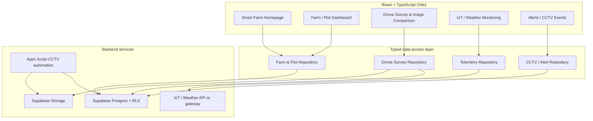
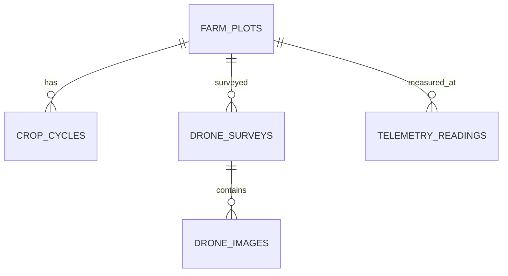

# Mahidol Smart Farm — Web Architecture & Roadmap

**Status:** Architecture proposal based on repository inspection on 2026-10-16  
**Repository:** `NaiBossZer/mahidol-smart-farm`  
**Principle:** Extend the existing website incrementally. Do not replace the current homepage or merge changes into `main` without review.

## 1. Executive summary

The project already has a React 19 + TypeScript + Vite frontend, a public Smart Farm homepage, a 3D model/learning experience, charts with sample IoT-like values, a survey-results dashboard backed by Google Apps Script, a drone image comparison prototype on a separate branch, and a Supabase schema/automation for CCTV events.

The key gap is integration: farm data is not yet presented through one persistent, well-defined data layer. The drone prototype keeps image files and survey records in page memory, so records disappear on refresh. Homepage sensor charts are hardcoded samples, not verified live telemetry. The CCTV table exists, but the public frontend does not yet read it. The existing `/dashboard` is for survey responses, not farm operations.

**Target:** evolve Smart Farm into a farm-monitoring and learning portal with plot-based history, drone imagery, IoT readings, weather, and later CCTV events—while clearly labelling live, delayed, sample, and unavailable data.

## 2. Existing architecture (observed)

### Frontend

- `src/main.tsx`: React Router routes currently include `/`, `/login`, `/dashboard`, and `/survey` on `main`.
- `src/routes/index.tsx`: large homepage component; contains navigation, six rotating hero slides, sample soil-moisture/weather series, and the 3D viewer script loader.
- `src/routes/dashboard.tsx`: survey-results dashboard. It checks `sessionStorage.dashboard_auth`, redirects to `/login`, and loads results from Google Apps Script.
- `src/components/dashboard/`: chart, filter, and display primitives for the existing survey dashboard.
- `src/components/`: learning onboarding, privacy consent, 3D learning game, and UI components.
- `src/data/`: learning/game data and zone definitions.
- `src/lib/`: analysis, export, error capture/page, Google Sheets-related utility, and common helpers.
- `src/hooks/`: currently a mobile hook.
- `vite.config.ts`: Vite, React, Tailwind CSS v4 plugin, and TypeScript path aliases.
- `package.json`: React 19, TypeScript, Vite, React Router, Recharts, Three.js/React Three Fiber, Tailwind, and UI libraries. No Supabase JavaScript client dependency is declared in the inspected package manifest.

### Data and automation

- `supabase/migrations/20260922_cctv_events.sql`: defines `cctv_events`, indexes, and RLS; authenticated users can read, and service-side automation writes events.
- `supabase/README.md`: documents the `cctv-snapshots` storage bucket and CCTV schema.
- `automation/gmail-line/Code.gs`: Google Apps Script for the CCTV email/snapshot/LINE notification workflow.
- Survey submission and survey dashboard currently use Google Apps Script endpoints.
- `feat/drone-crop-growth-module` contains a drone page prototype. It supports local image selection, plot/date/operator metadata, and side-by-side comparison, but explicitly reports that files and records are not persisted to a server/database.
- The repository contains only one checked-in Supabase migration in the inspected migration folder: the CCTV event migration.

### Current route caveat

Draft PR #4 proposes deleting `/login` and `/survey`, but the current dashboard still redirects unauthenticated users to `/login`. If those routes are removed, the old survey dashboard must also be removed, retired, or redesigned in the same rollout; otherwise its authentication flow is broken. Do not merge that route deletion independently without resolving this dependency.

## 3. Target information architecture

### Public site

- `/` — Smart Farm overview, learning content, 3D plot, and summary status cards.
- `/farm` — farm overview and plot selection.
- `/farm/plots/:plotId` — plot detail: latest readings, crop-cycle context, and survey history.
- `/farm/drone` — drone survey list, upload, metadata, and image comparison.
- `/farm/drone/:surveyId` — one drone survey and its images/metadata.
- `/farm/monitoring` — IoT and weather time series with data-source/status labels.
- `/farm/alerts` — future alert/event list, including CCTV when integration is ready.
- `/learning` — learning resources and 3D/interactive learning content (may remain sections within the homepage if that best preserves current UX).

### Internal/admin functions

Do not add a new public login system until the intended user roles and deployment requirements are agreed. If protected operational pages are required, implement server-verified authentication and authorization first; do not rely on a client-side password or `sessionStorage` as a security boundary.

Retire the old survey `/login`, `/survey`, and survey-results dashboard only as a coordinated change, since the dashboard currently depends on the login route.

## 4. Proposed logical architecture



The diagram is a target, not a statement that every connection exists today. Start by defining interfaces and status states; connect each source only when credentials, ownership, data shape, and access policies are confirmed.

## 5. Recommended code organization

Introduce this gradually; do not move every existing file in the first change.

```text
src/
  app/
    App.tsx
    routes.tsx
  components/
    layout/
    status/
    charts/
    drone/
    plots/
  features/
    farm-overview/
    plots/
    drone-surveys/
    telemetry/
    weather/
    alerts/
    learning/
  data-access/
    farm.repository.ts
    drone.repository.ts
    telemetry.repository.ts
    events.repository.ts
  lib/
    supabase.client.ts       # only after env/config is approved
    validation.ts
    date-time.ts
  types/
    farm.ts
    drone.ts
    telemetry.ts
    events.ts
  routes/
    index.tsx                # keep current homepage while extracting features
    dashboard.tsx            # replace/retire only with coordinated route decision
supabase/
  migrations/
  README.md
automation/
  gmail-line/
```

Use feature-level components and typed repository interfaces so UI components do not call multiple services directly. Preserve the existing design system, assets, homepage content, and 3D learning experience while extracting smaller pieces over time.

## 6. Data model proposal

These are proposed entities, not migrations already applied.

### `farm_plots`
- `id` UUID primary key
- `code` unique human-readable code (e.g. plot-a)
- `name`, `description`
- optional `geometry`/coordinates when reliable plot boundaries are available
- `created_at`, `updated_at`

### `crop_cycles`
- `id`, `plot_id` foreign key
- `crop_name`, `variety` (optional)
- `planted_at`, `expected_harvest_at`, `harvested_at` (nullable)
- `notes`, `created_at`

### `drone_surveys`
- `id`, `plot_id` foreign key
- `surveyed_at` timestamp with timezone
- `operator`, `drone_model`, `camera_type` (RGB/multispectral/unknown)
- `notes`, `status` (draft/uploading/ready/failed)
- `created_at`, `created_by` (nullable until auth is defined)

### `drone_images`
- `id`, `survey_id` foreign key
- `storage_path` (canonical reference; avoid storing only a public URL)
- `original_filename`, `mime_type`, `size_bytes`
- optional `capture_time`, `latitude`, `longitude`, `altitude_m`
- optional `image_role` (overview/detail/before/after)
- `created_at`

### `telemetry_readings` (only if no existing upstream store/API can be reused)
- `id`, `plot_id` or `sensor_id`
- `measured_at` timestamp with timezone
- `metric` (soil_moisture, air_temperature, air_humidity, rainfall, etc.)
- `value`, `unit`, `quality_status`, `source`
- unique/source key to prevent duplicate imports

### Existing `cctv_events`
Keep the current table and its security intent. Integrate through a repository with read access only for authorized users; do not expose service-role credentials in the browser.

### Relationships



Before creating migrations, confirm whether an existing IoT provider/database already owns telemetry and whether farm/plot identifiers can be mapped consistently. Avoid copying data into a second database without a reason.

## 7. Data-source rules

Every chart, KPI, and image record should expose a clear state:

- **Live** — source reports a recent value and a verified update time.
- **Delayed** — source works, but latest data is older than the configured freshness threshold.
- **Sample** — fixed/demo values; never label as real-time.
- **Unavailable** — no valid reading or source error.
- **Processing** — image upload/analysis has not finished.

Store timestamps in UTC; display in Asia/Bangkok. Keep source, unit, timestamp, and quality metadata. Missing data must not silently become zero.

## 8. Drone workflow (first priority after architecture approval)

1. Select plot and survey date/time; record operator, drone, camera type, and notes.
2. Validate image type, size, and count; show upload progress and useful errors.
3. Upload images to a private Supabase Storage bucket; store metadata in `drone_surveys` and `drone_images`.
4. List survey history by plot/date and allow before/after selection.
5. Generate time-limited signed URLs for private images.
6. Add RGB visual comparison first. Do not label RGB comparison as NDVI or an automated plant-health diagnosis.
7. Add georeferenced orthomosaics, vegetation indices, or other analysis only when suitable imagery and a processing pipeline are available.

Use retry-safe upload behavior and a cleanup policy for orphaned files. Enforce file limits and access policy on the server/storage side, not just in the UI.

## 9. Security and reliability

- Never put Supabase service-role keys, LINE tokens, or private API credentials in frontend code.
- Use environment variables for public configuration, and server-side/automation secrets for privileged operations.
- Enable RLS for new tables and write least-privilege policies based on confirmed user roles.
- Do not treat `sessionStorage` or a hardcoded client-side password as real authentication.
- Validate uploads and inputs; limit image file types and sizes.
- Add loading, empty, error, retry, and stale-data states.
- Keep telemetry and event ingestion idempotent.
- Log upload/processing failures without exposing secrets or private data.
- Do not assume the existing public test Storage bucket is suitable for production images.

## 10. Delivery roadmap

### Phase 0 — Architecture and baseline
- Approve this target architecture and the page/route list.
- Decide whether the old survey dashboard is to be removed, archived, or repurposed.
- Inventory actual IoT endpoints, units, update frequency, and plot/sensor identifiers.
- Confirm Supabase project, environment-variable names, bucket privacy, and RLS policy owners.
- Record baseline build/lint/smoke status before implementation.

### Phase 1 — Web foundation
- Keep the current homepage intact.
- Extract shared status cards, chart wrappers, plot selector, and data-source labels.
- Add the farm/plot navigation shell and route skeletons.
- Replace sample-data ambiguity with explicit `Sample` labels.
- Resolve old `/login` and `/survey` routes together with the survey dashboard dependency.

### Phase 2 — Persistent drone history
- Add migrations for plots/surveys/images after schema review.
- Implement private Storage upload, metadata persistence, validation, retry, and upload progress.
- Implement survey list/detail and before/after comparison from stored records.
- Verify reload, another browser session, authorization, and file access behavior.

### Phase 3 — Real IoT and weather
- Connect to the existing source of truth, if available.
- Normalize sensor identifiers, units, timestamps, and freshness.
- Add per-plot time series and clear live/delayed/unavailable states.
- Keep sample mode for demos, visibly separate from production readings.

### Phase 4 — Cross-source insights
- Correlate drone surveys and telemetry by plot and time window.
- Show timelines and contextual comparisons, not unsupported causal claims.
- Add downloadable reports with source and timestamp metadata.

### Phase 5 — CCTV and notifications
- Read existing `cctv_events` through authorized access.
- Display event history and snapshot links; show notification status.
- Verify policies and signed/public URL strategy before exposing snapshots.

### Phase 6 — Advanced analysis
- Add geospatial orthomosaic and multispectral analysis only if capture hardware and processing data support it.
- Version analysis outputs and preserve original images.
- Validate metrics against field observations before presenting them as decisions.

## 11. Acceptance criteria

- Existing homepage, navigation, assets, and 3D learning content remain functional.
- All routes have a defined purpose and no dead redirects.
- Sample data is visibly identified; no fake “real-time” claims.
- Drone survey metadata and image records survive reload and are available to authorized users.
- Before/after comparisons are tied to plot and survey date.
- No privileged secret is shipped to the browser.
- RLS, upload limits, and private image access are tested.
- Loading, empty, error, retry, and stale states are covered.
- `npm run build`, `npm run lint`, and `npm run smoke` results are recorded in the PR.
- Changes are reviewed in a preview deployment and are not merged to `main` without explicit approval.

## 12. Files reviewed

- `package.json`
- `src/main.tsx`
- `src/routes/index.tsx`
- `src/routes/dashboard.tsx`
- `src/components/dashboard/`
- `src/components/`
- `src/data/`
- `src/hooks/`
- `src/lib/`
- `supabase/README.md`
- `supabase/migrations/20260922_cctv_events.sql`
- `automation/gmail-line/Code.gs`
- `src/routes/drone-crop-growth.tsx` on `feat/drone-crop-growth-module`

This document describes the inspected repository and a proposed target. It does not claim that the target services, schema, or routes have already been implemented or tested.
